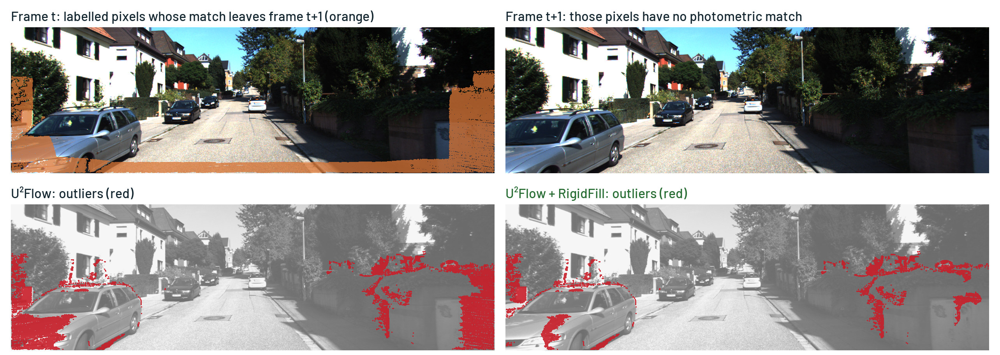

# Where Photometry Is Blind

**Inference-Time Geometric Correction of Unsupervised Optical Flow in Driving Scenes**

Authors to be announced.

[Project page](https://huynhdotanthanh.github.io/where-photometry-is-blind/) &nbsp;|&nbsp; Paper: coming soon &nbsp;|&nbsp; [MIT licence](LICENSE)



Unsupervised optical flow learns from photometric consistency, so a pixel that leaves the next
frame gets no direct training signal. On the KITTI 2012 training set (KITTI-12), such
out-of-frame pixels are 13.1% of the labelled pixels but 44.0–44.5% of the outliers of three
unsupervised networks (U²Flow, ARFlow, Sun-RAFT), and their outlier rate is more than five times
that of the other pixels (post-hoc analysis). **RigidFill** corrects a frozen network at
inference time: it estimates the camera motion from the network's reliable correspondences,
triangulates the backward correspondences to get depth, reprojects the scene into the next
camera, and replaces the network's flow with this rigid flow only where the network is
uncertain. It changes no network weights, but its replacement source, gate form and thresholds
were selected on 100 labelled development images. It needs three frames and calibrated
intrinsics.

## Key results

Fl is the KITTI outlier rate (%): the share of labelled pixels whose flow error exceeds both 3 px and
5% of the true flow magnitude. Gain = base Fl minus corrected Fl, in percentage points (pp),
with its 95% paired image-bootstrap interval.

| Evaluation | U²Flow | + RigidFill | Gain (pp) | Analysis |
|---|---:|---:|---|---|
| KITTI-15 held-out half (100 images), read once | 7.384 | **6.949** | 0.434 [0.259, 0.633] | pre-specified, primary |
| KITTI-12 (194 images) | 4.130 | **3.613** | 0.517 [0.396, 0.644] | pre-specified |
| HD1K (outlier threshold scaled to its resolution) | 1.571 | 1.548 | no harm beyond a declared margin; the rule barely acts (replaces 0.36% of labelled pixels); not a transfer test | plan declared before scoring |

- **Other networks** (KITTI-12, post hoc): ARFlow gains 0.99 pp and Sun-RAFT 0.66 pp, each with
  its own gate; the out-of-frame outlier rate of all three networks falls by 25–30%.
- **Against U²Flow's learned per-image fusion (+FF)**: better on KITTI-12 at each of three +FF
  seeds, by 0.394, 0.383 and 0.385 pp (post hoc); on the held-out half the pre-specified
  comparison is inconclusive.
- **Runtime** (median per image on one GPU, all network passes included): network alone 22.2 ms,
  RigidFill 1,036.2 ms, +FF 2,484.9 ms. RigidFill takes 0.42× the time of +FF and 46.7× that of
  the network alone: it suits offline or accuracy-first use, not real-time inference.

**Limitations.** No measured gain on moving objects (KITTI-15 development half, out of fold:
0.571 pp, 95% CI [−0.388, 1.849]); the correction increases the error on MPI Sintel's
non-rigid scenes; it needs three frames and calibrated intrinsics; its thresholds were selected
on 100 labelled development images. "Post hoc" marks analyses designed after the first KITTI-12
evaluation on images already used for a decision, as in the paper.

## What is in this repository

```
tools/
  p1/          RigidFill: network evidence, self-triangulation, rigid rendering, the gate,
               the comparisons with +FF and other sources, timing
  p1/p1lib/    shared helpers: cache format, KITTI frames and calibration, the U²Flow wrapper
  eval/        KITTI evaluation, error regions, statistics, re-scoring of cached predictions
  lib/         the frozen-plan reader and the ledger writer the evaluation tools import
  prereg/      seal.py: how the held-out labels were kept apart
  teacher/     cache format and dependencies of the external geometry sources (comparisons)
  vm/          GPU-VM helpers and the SAM mask producer of the benchmark entry
  data/        build_bundles.py, imported for its deterministic zip writer
prereg/        the pre-specified analysis plan (PRIMARY.json), its recorded limitations, and
               the prereg-v3 tag manifest with its OpenTimestamps proof
splits/        the KITTI-15 development/held-out split (100 + 100 images)
docs/          the project page (GitHub Pages, served from /docs)
SHA256SUMS     SHA-256 of every file under tools/, prereg/ and splits/
```

The files under `tools/`, `prereg/` and `splits/` are byte-identical to the reviewer package
built from the authors' research repository (`shasum -a 256 -c SHA256SUMS`). They were not
edited for this release, because the analysis plan pins the analysis code by SHA-256. Comments
and docstrings name record ids of the authors' internal ledger (EV-, RES-, IDEA- and similar);
they are kept for traceability, and the ledger itself is not included. Some modules carry the
authors' local paths as defaults; pass your own paths on the command line.

The files in `prereg/` and `splits/` are records of the pre-registration, published as they
were frozen; the MIT licence covers the code.

**Not included:** U²Flow's code and checkpoints, which come from
[github.com/sunzunyi/U2FLOW](https://github.com/sunzunyi/U2FLOW) (Sun et al., CVPR 2026; that
repository ships no licence); the code of RAFT, ARFlow and Sun-RAFT, which `dump_eval.py` loads
from their own checkouts; datasets, predictions, caches and the authors' data manifests.

## Requirements

- Python 3.10 or newer.
- `numpy` and `opencv-python` (essential matrices, pose recovery, error regions) for the
  geometry, the gate and the evaluation.
- `torch` for the network passes (`dump_eval.py`, `eval_kitti.py`, `gpu_refit.py`,
  `time_arbitration.py`) and the GPU triangulation; `imageio` for reading frames.
- A checkout of [U²Flow](https://github.com/sunzunyi/U2FLOW) with its released KITTI checkpoint:
  the modules import its `configs`, `core` and `train_fusion_kitti` modules.
- Optional: `threadpoolctl` (timing), `requests` (data bundles), and `Pillow` with
  `segment_anything` (the SAM masks of the benchmark entry only).

The modules expect to sit at `tools/` inside a U²Flow checkout. They find the repository root
from their own location, import U²Flow's packages from it, and read KITTI 2012 and KITTI 2015
from a data root. They are provided for reading and checking the method; running them end to end
needs those inputs.

## How the pieces fit

1. **Network evidence.** `tools/p1/dump_eval.py` runs the frozen network on frames *t*−1, *t*,
   *t*+1 of each KITTI sequence and caches the forward flow *S*, its uncertainty *α*, the
   backward flow *F*<sub>b</sub> and the forward–backward visibility (`p1lib/u2flow.py` wraps
   U²Flow's own loader, network and occlusion test). ARFlow, Sun-RAFT and RAFT run through the
   same entry point.
2. **Camera motion and depth.** `tools/p1/self_triangulate.py` estimates the two relative poses
   with a five-point RANSAC on visible, in-frame, low-uncertainty correspondences, triangulates
   every visible backward correspondence to get the depth *D*<sub>b</sub>, and aligns the two
   baselines by a median depth ratio.
3. **Rigid flow.** `tools/p1/render_frig.py`, with `tools/p1/rigid.py`, reprojects each pixel
   with a backward depth into camera *t*+1. The rigid flow *T* is defined whether or not the point
   stays in view, and is carried to native resolution as the network's flow is.
4. **Gate and evaluation.** `tools/p1/arbitration_cv.py` holds the frozen rule
   (`FROZEN_ALPHA_GT`, `FROZEN_D_LE_PX`: replace *S* by *T* where *α* exceeds the threshold and
   *T* lies within the distance bound of *S*) and the selection procedure on the development half;
   `selftri_vs_ff.py` compares it with +FF; `render_heldout.py` renders *T* for the held-out
   images; `tools/eval/` scores Fl and the paired image bootstrap (`eval_kitti.py`, `regions.py`,
   `stats.py`, `score_cached.py`).
5. **The rule on fresh inputs.** `tools/p1/selftri_train_maps.py` (`selftri_maps`) applies the
   whole rule to new network outputs on the CPU; `gpu_refit.py` and `exact_refit_par.py` are the
   faster implementations, and `time_arbitration.py` measures the runtimes.

The other modules (`arbitrate.py`, `arbitrate_run.py`, `composite_bound.py`, `region_table.py`,
`refine_pose.py`, `gate_maps.py`, `tools/teacher/`, `tools/vm/`) belong to the comparisons and
experiments reported in the paper and its supplement, and to the import closure of the files
above.

## Verifying the pre-registration

Before the held-out labels were read, the analysis plan fixed the compared methods, the
endpoint, the interval levels, the multiplicity rule and the sentence to be reported for each
outcome. The version-control tag `prereg-v3` froze it with the split.

1. The plan file:

   ```bash
   shasum -a 256 prereg/PRIMARY.json
   # ce8e7bf5617f4f3f9723b3d269ec3f75041e13ba75c218adfb94cdbf0bea241a
   ```

2. The tag's manifest `prereg/tags/prereg-v3.json` lists the SHA-256 of every plan and split file
   at the tag. Three of them are in this repository:

   ```bash
   python3 -c 'import hashlib, json; m = json.load(open("prereg/tags/prereg-v3.json"))["files"]; [print("OK" if hashlib.sha256(open(p, "rb").read()).hexdigest() == m[p] else "MISMATCH", p) for p in ("prereg/PRIMARY.json", "prereg/limitations.md", "splits/k15_split_v1.json")]'
   ```

   The other entries are the gate criteria, drafts and inputs of the pre-registration.

3. The Bitcoin anchor of the manifest (OpenTimestamps client,
   `pip install opentimestamps-client`; `ots verify` needs a Bitcoin node, see
   `--bitcoin-node`):

   ```bash
   shasum -a 256 prereg/tags/prereg-v3.json
   # 445073fbc1115a14e9769863f92e88589bdd613ba04fac399af4890d4b4eda7b  (the hash the proof commits to)
   ots verify prereg/tags/prereg-v3.json.ots
   ```

   Without a node: in the output of `ots -v info prereg/tags/prereg-v3.json.ots`, the value on
   the line before `verify BitcoinBlockHeaderAttestation(971068)`, read byte-reversed, must equal
   the merkle root of block 971,068 shown by any block explorer:
   `7a7918be68a5f722ab83adf5aab3ecb8335042c7c10d1f9ea4279c7a6934bf96`.

4. Timing, all on 12 October 2026 (UTC): the tag `prereg-v3` was created at 08:43:09, the
   held-out score was recorded at 08:43:48, and Bitcoin block 971,068 was mined at 09:03:40. The
   proof therefore shows that the plan has not changed since that block was mined; that the tag
   came before the held-out read rests on the repository history, not on the proof.

The plan pins its analysis code by SHA-256 (the `code_sha256` maps in `prereg/PRIMARY.json`).
Every pinned file in `tools/` matches its pin; the one pinned file not included is U²Flow's
`core/utils/flow_utils.py`.

## Citation

```bibtex
@misc{rigidfill2026,
  title        = {Where Photometry Is Blind: Inference-Time Geometric Correction
                  of Unsupervised Optical Flow in Driving Scenes},
  author       = {Authors to be announced},
  year         = {2026},
  howpublished = {\url{https://huynhdotanthanh.github.io/where-photometry-is-blind/}}
}
```

## Use of AI tools

Coding agents based on large language models (Anthropic's Claude through Claude Code, and
OpenAI's Codex) were used in this work to write and review code and to run experiments under
decision rules recorded in advance; Claude also drafted and edited text, including this README. The
authors reviewed the results and take responsibility for them; the paper's declaration gives the
details.

## Licence

The code is released under the [MIT licence](LICENSE). The files in `prereg/` and `splits/` are
records of the pre-registration. Images in `docs/assets/img/` derived from the KITTI Vision
Benchmark Suite are shared under CC BY-NC-SA 3.0, as KITTI is. The fonts in
`docs/assets/fonts/` (Barlow, Source Serif 4) are under the SIL Open Font License 1.1.
U²Flow's code and checkpoints are not part of this repository.

## Acknowledgements

We thank the authors of the KITTI benchmarks (Geiger, Lenz and Urtasun, CVPR 2012; Menze and
Geiger, CVPR 2015), MPI Sintel (Butler et al., ECCV 2012) and HD1K (Kondermann et al., CVPR
Workshops 2016) for their datasets, and the authors of
[U²Flow](https://github.com/sunzunyi/U2FLOW) (Sun et al., CVPR 2026),
[ARFlow](https://github.com/lliuz/ARFlow) (Liu et al., CVPR 2020) and
[Sun-RAFT](https://github.com/cv-stuttgart/Sun-RAFT) (Jahedi et al., WACV 2026) for releasing
their code and checkpoints.
